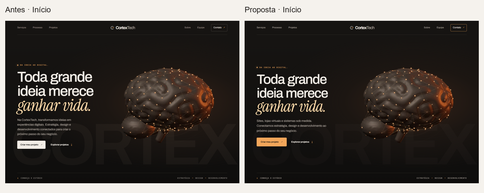
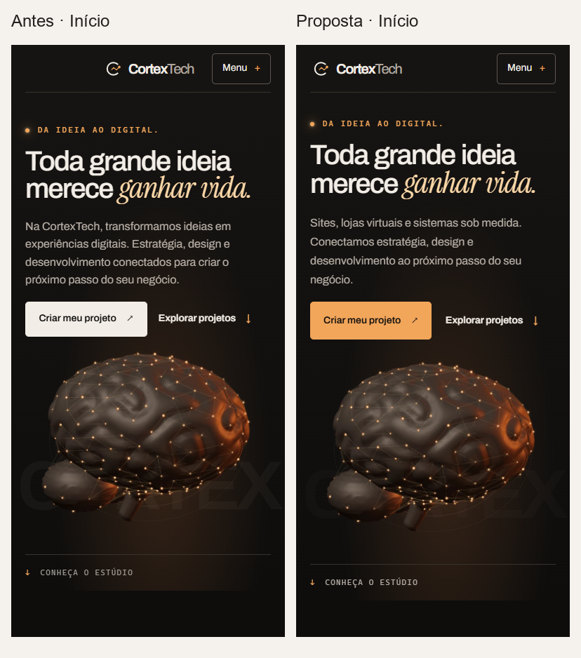
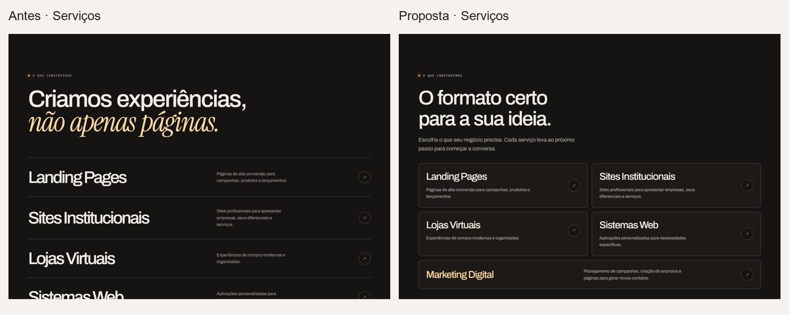
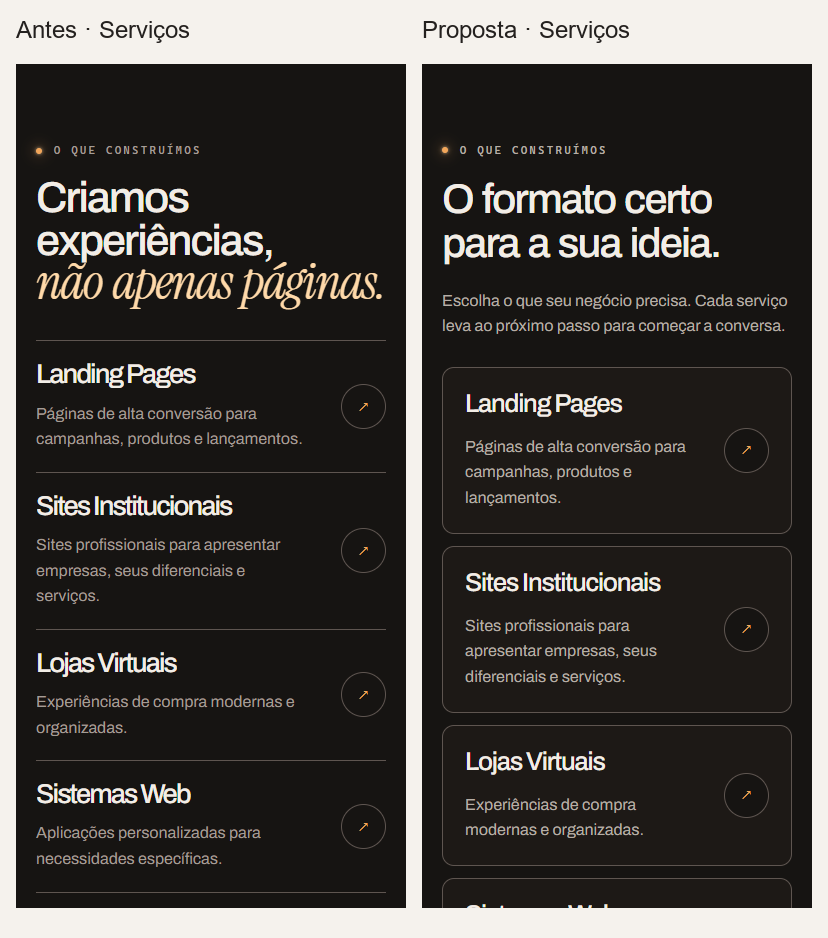
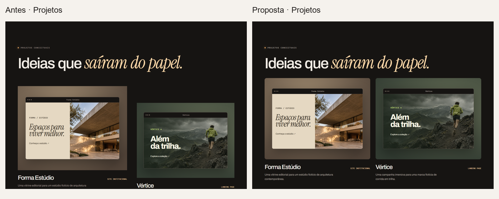
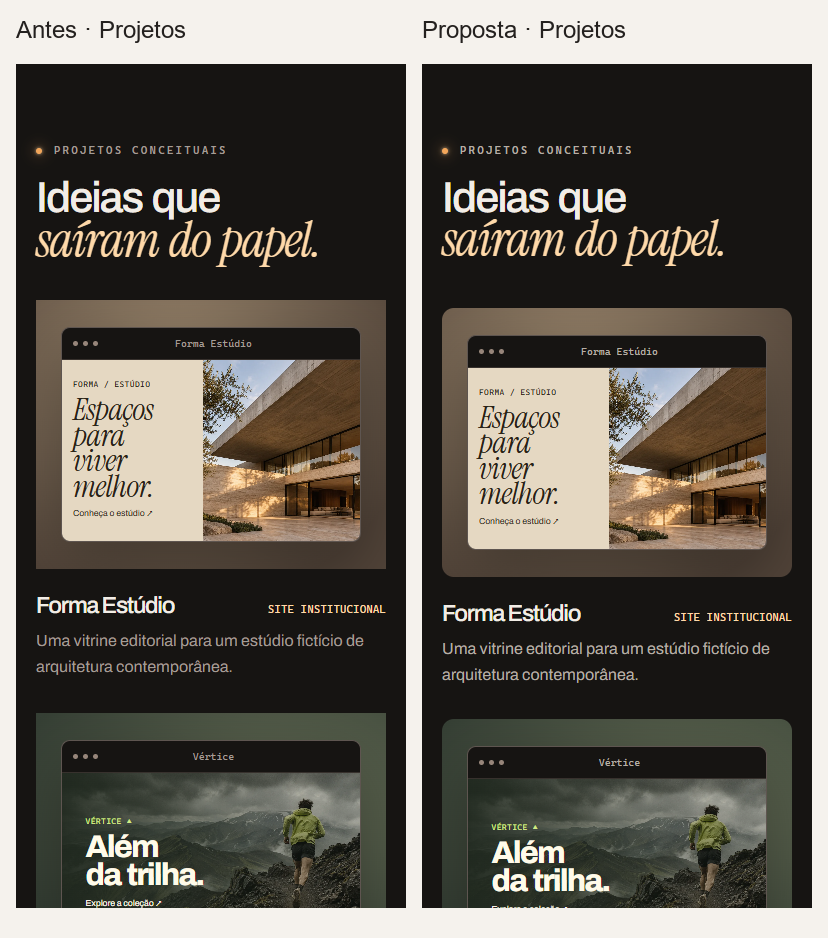
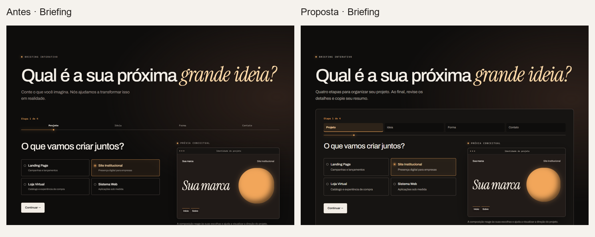
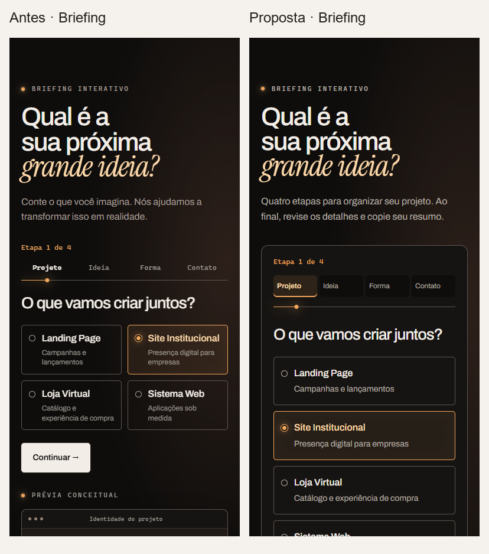
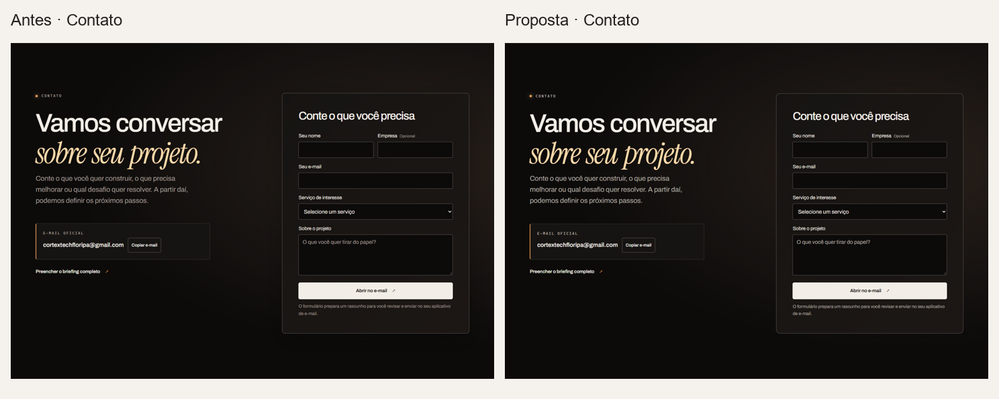
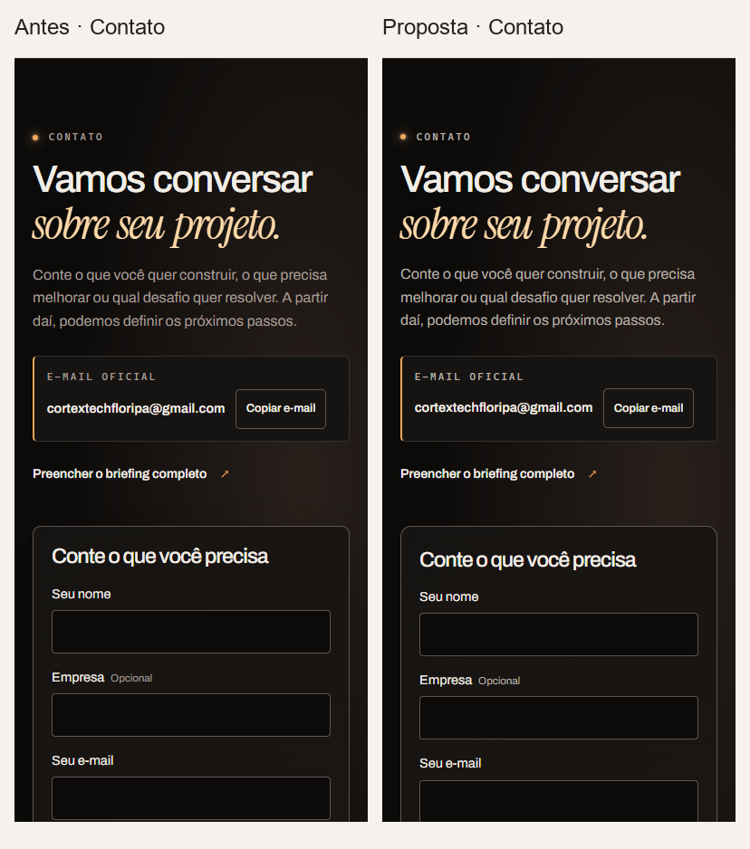

# Proposta visual CortexTech

Comparações locais de antes e depois, orientadas pelo método MONSTRUX. Em cada
imagem, a versão original está à esquerda e a proposta à direita.

Base: `be0cc531542836a23d431e1bf8f9979ad3d452d3`. Capturas em 26/11/2026 com
Microsoft Edge headless via Playwright, idioma pt-BR, tema escuro, texto a 100%
e DPR 1. Desktop: 1440 × 1000; celular: 390 × 844. Ambos os lados usam movimento
reduzido; o cérebro aparece como imagem estática de fallback nessa condição.
As capturas mostram o estado inicial, sem dados pessoais preenchidos.

## Mudanças

- Mensagem inicial mais específica e ação principal destacada em laranja.
- Marca alinhada à esquerda no cabeçalho móvel.
- Serviços em duas colunas no desktop e uma no celular.
- Projetos alinhados e briefing delimitado por uma superfície própria.
- Etapa ativa mais evidente, descrições maiores e maior contraste secundário.

## Comparações

### Início

### Serviços

### Projetos

### Briefing

### Contato

## Validação local

- `npm test`: 4 aprovados.
- `npm run build`: aprovado.
- `git diff --check`: sem problemas.
- `PLAYWRIGHT_CHANNEL=msedge npm run test:e2e`: rodada final com 10 aprovados
  e 1 ignorado por exigir WebGL de software.
- O teste de toque foi executado separadamente com
  `PLAYWRIGHT_CHANNEL=msedge PLAYWRIGHT_SOFTWARE_WEBGL=1 npx playwright test tests/touch.spec.js`:
  1 aprovado, cobrindo arrasto horizontal e rolagem vertical.

Na primeira rodada, o teste de pausa do carrossel apresentou uma diferença de
10 px. O teste isolado no original e a repetição completa na candidata passaram.
A intermitência permanece registrada; o código do carrossel não foi alterado.

As verificações automatizadas incluem axe A/AA, mas não constituem certificação
de acessibilidade, pesquisa com usuários ou teste em dispositivo físico. Não houve
teste com leitor de tela nem envio real em produção. Foi aplicado o método do
perfil e das skills MONSTRUX disponíveis localmente; o runtime isolado não foi
acionado. Publicação deste PR solicitada explicitamente pela pessoa responsável.
